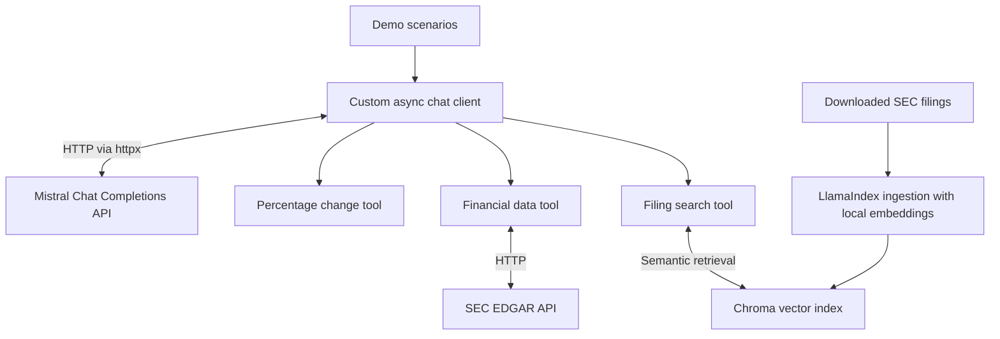

# Keel

A learning project for building AI applications with multiturn chat, tool
calling, retrieval-augmented generation (RAG), and external data integrations.
It uses async Python to build on Mistral's Chat Completions HTTP API.

- Supports multiturn chat by preserving conversation history between turns.
- Implements basic tool calling: registers Python functions with tool schemas,
  executes requested functions, and sends their results back to Mistral to
  continue the conversation.
- Retrieves historical public-company revenue and operating income from SEC
  EDGAR.
- Searches locally indexed SEC filings for relevant passages using semantic
  retrieval to support retrieval-augmented generation (RAG).
- Uses that data to answer natural-language finance questions.

The goal is to learn how language models, conversation state, tool execution,
and retrieval work together to answer questions using external data, while
practicing modern async backend development.

## Example output

Excerpts from recorded demo runs, formatted for readability. Tool payloads and
long answers are abbreviated; model responses can vary.

The `multiturn` demo preserves history across follow-up questions:

```text
User: Calculate the percentage increase from 120 to 150 using the tool.
Tool: calculate_percentage_change(old=120, new=150) → 25.0
Assistant: The percentage increase from 120 to 150 is 25%.

User: Now calculate the percentage increase from 150 to 210 using the same tool.
Tool: calculate_percentage_change(old=150, new=210) → 40.0
Assistant: The percentage increase from 150 to 210 is 40%.

User: Which of these two increases was larger, and by how many percentage points?
Assistant: The first increase was 25%, and the second was 40%.
           The second increase was larger by 15 percentage points.
```

The `financials` demo runs two independent questions using external data tools:

```text
User: Did Microsoft's operating margin improve between FY2023 and FY2025?
Tool: get_company_financials(ticker="MSFT", start_year=2023, end_year=2025)
      → [SEC revenue and operating income observations omitted]
Assistant: The operating margin increased from 41.8% in FY2023 to 45.6% in
           FY2025, representing a 3.8 percentage point improvement over this period.
```

```text
User: What risks does Microsoft identify related to artificial intelligence?
Tool: search_filings(ticker="MSFT", query="artificial intelligence risk",
                     years=[2022, 2023, 2024])
      → [3 passages from MSFT-2024-10k.html and MSFT-2023-10k.html omitted]
Assistant: [Excerpt]
           Flawed algorithms or training methodologies: AI systems may produce
           inaccurate, biased, or harmful outputs due to fundamental flaws in
           their design or training processes.
           [...]
```

## How it works



The [chat client](app/mistral_chat.py) calls Mistral's Chat Completions HTTP API
directly using `httpx`, without a Mistral SDK. It maintains conversation history,
executes registered tools requested by the model, and sends their results back
to the model until it answers or reaches the tool-calling round limit.

The RAG pipeline uses [LlamaIndex ingestion](scripts/rag_index.py), local Hugging
Face embeddings, and Chroma to index SEC filings. The
[filing retriever](app/filing_retriever.py) searches for relevant passages,
filtered by ticker and year, and returns text with source filenames. Retrieval
is exposed as a tool, so the model can request document context before answering.
The [financial data tool](app/edgar.py) separately fetches structured revenue and
operating income observations from SEC EDGAR.

## Quick setup

With uv installed, run these commands from the project root (Python 3.12 is
selected by `.python-version`):

```sh
uv sync

# Work around NLTK rejecting hard-linked LlamaIndex data files.
UV_LINK_MODE=copy uv sync --reinstall-package llama-index-core
```

Create a `.env` file containing your Mistral API key and SEC contact details:

```dotenv
MISTRAL_API_KEY=your-api-key
EDGAR_API_USER_AGENT="Your Name your.email@example.com"
```

Download Microsoft's annual SEC filings into `data/documents` (filings are not
included in Git):

```sh
mkdir -p data/documents
uv run python -m scripts.get_sec_filings MSFT --year 2024 2025 2026 2023
```

Then manually build the Chroma index:

```sh
uv run python -m scripts.rag_index
```

To rebuild an existing index after changing the documents, delete `data/chroma/`
before running the indexer again.

Choose a demo (`hello_world`, `simple_tool_call`, `multiturn`, or `financials`):

```sh
uv run python -m app.main multiturn
uv run python -m app.main financials
```

Only `financials` requires the downloaded filings and built index; the other
demos can run after installing dependencies and configuring the Mistral API key.
